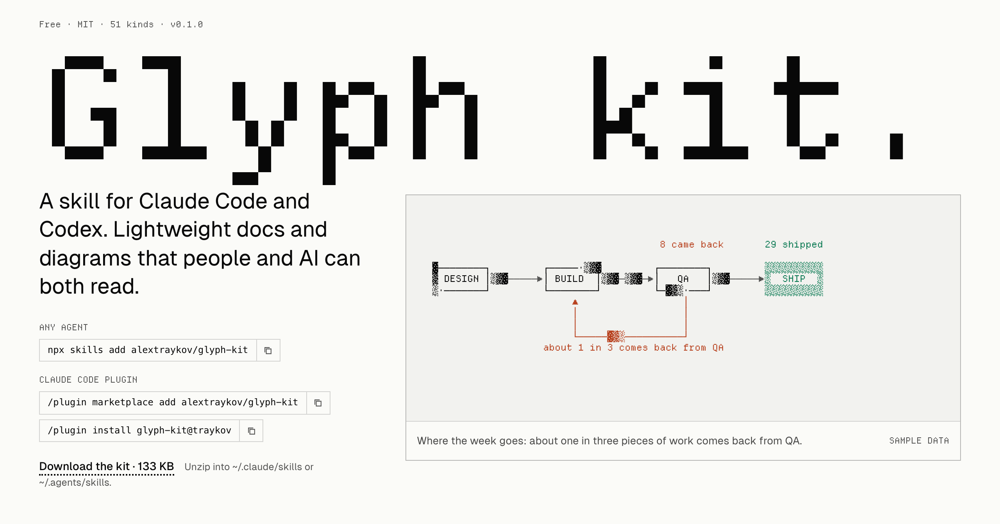
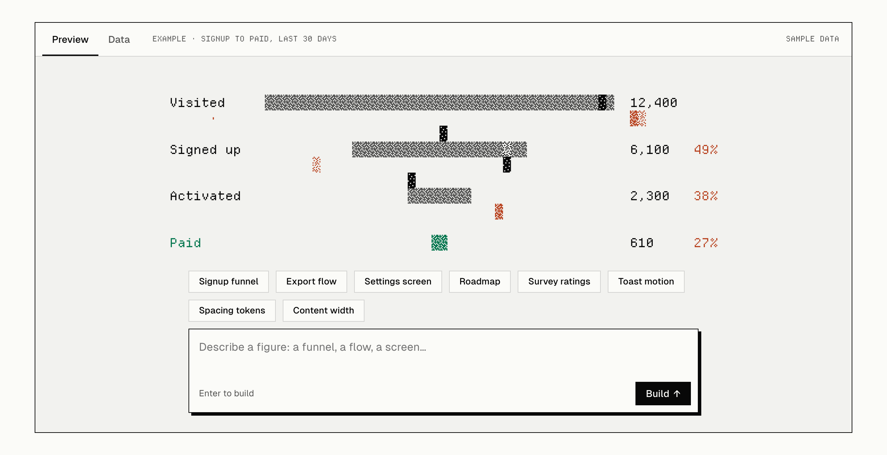
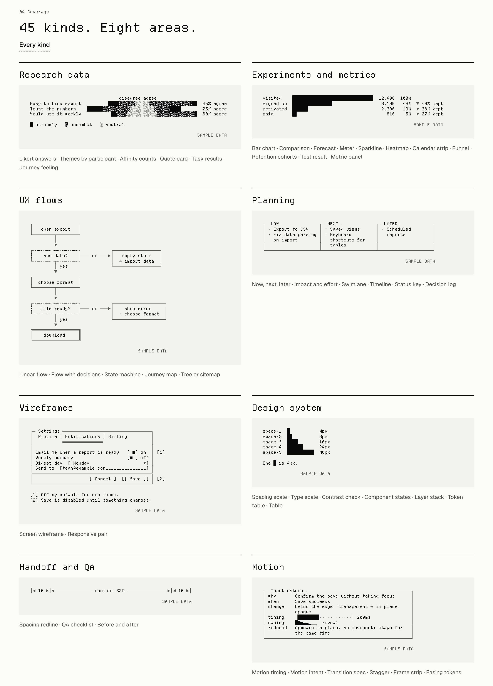

<p align="center"></p>

# Glyph kit

**Get the point across clearly, cheaply, in an aesthetic that doesn't date.**

<p align="center"><a href="https://glyph-kit.traykov.cc"></a></p>

A skill for Claude Code and Codex that draws product-design work in four shades and a few lines: research results, funnels and tests, flows, roadmaps, wireframes, design-system docs, handoff checklists, motion specs and moving diagrams. The agent writes a small spec, and code draws the figure, so the bars always match their numbers. The same spec becomes Markdown for a PR, a deck you present, a report as a PDF, an SVG for a slide, or a prototype built with your design system.

```text
┌─────────────────┐
│   open export   │
└────────┬────────┘
         │
         ▼
┌┄┄┄┄┄┄┄┄┄┄┄┄┄┄┄┄┄┐           ┌─────────────────┐
┆    has data?    ├─── no ───►│   empty state   │
└┄┄┄┄┄┄┄┄┬┄┄┄┄┄┄┄┄┘           │  → import data  │
         │ yes                └─────────────────┘
         ▼
╔═════════════════╗
║    download     ║
╚═════════════════╝
```

## Try it in the browser

Describe a figure on [glyph-kit.traykov.cc](https://glyph-kit.traykov.cc) and the builder draws it live, with nothing to install.



## Install

**Any agent** (Claude Code, Codex, Cursor and others):

```bash
npx skills add alextraykov/glyph-kit
```

**Claude Code**, as a plugin that updates:

```text
/plugin marketplace add alextraykov/glyph-kit
/plugin install glyph-kit@traykov
```

**By hand:** download the zip from the [latest release](https://github.com/alextraykov/glyph-kit/releases/latest) and unzip it into `~/.claude/skills/` (Claude Code) or `~/.agents/skills/` (Codex).

**Font, recommended:** [Departure Mono](https://departuremono.com), free under the SIL Open Font License. It draws every block and box character at exactly one cell, so figures line up. Any monospace font that covers ░▒▓█ and box drawing works; the kit doesn't require it.

Then ask for what you need, the way you'd ask a colleague: "chart these usability results for the PR", "a wireframe for the notification settings", "a motion spec for the toast, including reduced motion".

## What it draws



| Area | Types |
|---|---|
| Research data | Likert answers, themes by participant, affinity counts, quote card, task results, journey feeling |
| Experiments and metrics | Funnel, retention cohorts, test result, metric panel, bar chart, comparison, forecast, meter, sparkline, heatmap, calendar strip |
| UX flows | Flow with decisions, linear flow, state machine, journey map, tree or sitemap |
| Planning | Now/next/later, impact and effort, swimlane, timeline, status key, decision log |
| Wireframes | Screen, responsive pair |
| Design system | Spacing scale, type scale, palette, colour roles, contrast check, component states, layer stack, token table, table |
| Handoff and QA | Spacing redline, QA checklist, before and after |
| Motion | Motion timing, motion intent, transition spec, stagger, frame strip, easing tokens |
| Processes | Rework loops, queues, rollouts, loading sequences, state machines |
| Moving diagrams | Rework loop, funnel, state machine, work queue, staged rollout, loading sequence |

See every one at **[traykov.cc/glyph-kit](https://traykov.cc/glyph-kit)**.

## Why text

- **Cheap to make.** A figure takes microseconds to draw and is a few hundred bytes, about 65× smaller than a screenshot of it.
- **Exact.** Code draws from the numbers, so a bar can't disagree with its value, and the same spec always gives the same figure.
- **Works anywhere text does.** PRs, tickets, READMEs, Slack, terminals, a model's context, print.
- **A baseline, not a dead end.** Agree the structure in text, then raise the same spec to a prototype, a deck, a report or production code.

What's measured and what isn't: [benefits](docs/benefits.md). Text tokens aren't measured yet, and the kit says so.

## Guardrails

- **No source, no numbers.** A figure with numbers needs a source.
- **Made-up data is stamped** SAMPLE DATA in every format.
- **Data from your files:** `"data": "@results.csv"`.
- **Each type refuses data that can't be true**, in plain words.
- **Pass specs, not drawings,** between agents; `--compact` for plain ASCII when a drawing must go into a model's context.

## Colour

Figures are coloured by role, never for decoration: problems, passes, data and lines. Pick one of five palettes, or your own colours and tokens; every colour is checked for contrast. In a terminal the text is coloured too, and `NO_COLOR` turns it off. Without colour, every figure reads the same. Guide: [colour](skills/glyph-kit/reference/colour.md).

## Editing

A figure in Markdown can keep its spec beside it. Change the spec and `redraw` draws it again in place; edit a table, checklist or board by hand and `read` writes the change back to its spec. `check` lists every problem with a spec at once. Guide: [editing](skills/glyph-kit/reference/editing.md).

## Without an agent

Node 18 or later, nothing to install:

```bash
node skills/glyph-kit/scripts/glyph-kit.mjs types
node skills/glyph-kit/scripts/glyph-kit.mjs render skills/glyph-kit/examples/product/settings.spec.json --to markdown
node skills/glyph-kit/scripts/glyph-kit.mjs export skills/glyph-kit/examples/reports/motion-audit.json --to pdf
node skills/glyph-kit/scripts/glyph-kit.mjs check notes.md
node skills/glyph-kit/scripts/glyph-kit.mjs redraw notes.md
```

## Using it in your own work

The kit is MIT licensed. Use it in commercial work, change it, ship it inside your own tools; keep the licence notice in copies of the code. Figures you draw with it are yours, with no credit needed. If you'd like to credit it, "Drawn with Glyph kit" and a link is plenty.

Departure Mono, which the HTML pages embed, has its own licence (SIL Open Font License); its notice travels with every page that carries it.

## Contributing

New types, fixes, ports and integrations with editors and tools are all welcome. Start with [CONTRIBUTING.md](CONTRIBUTING.md); to add a type, [adding a type](docs/adding-a-type.md) walks through one end to end. The kit has no dependencies and keeps it that way.

## License

MIT. Made by [Alexander Traykov](https://traykov.cc). The story behind it: [Four characters](https://traykov.cc/notes/four-characters/).
