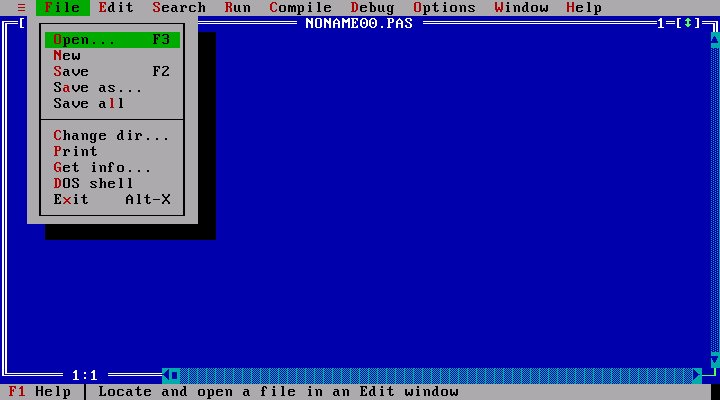
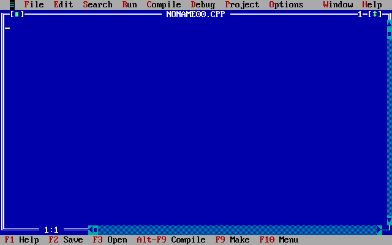
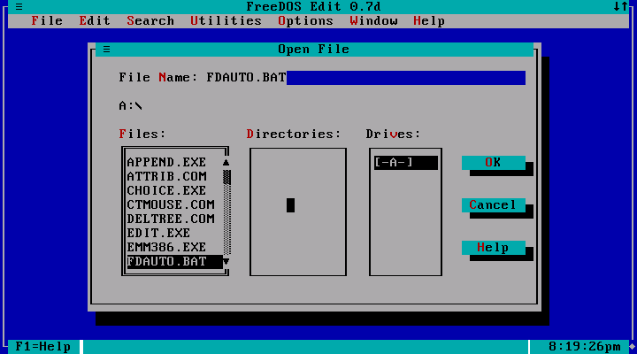
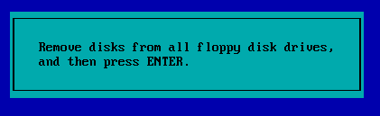
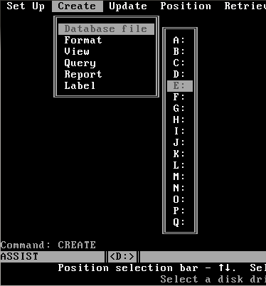
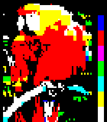
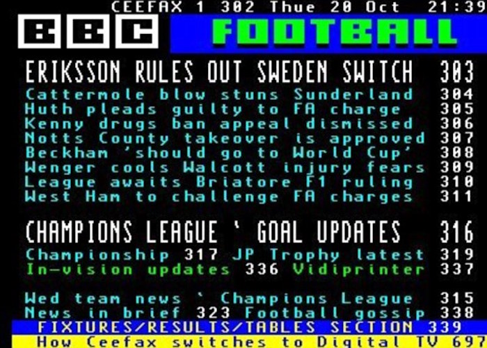

# Precedent

Block and box characters were how text-mode software drew interfaces for about twenty years. Use this file when a user asks where the vocabulary comes from, or wants a period-accurate example. Every claim has a source; screenshots are in `images/` with their licences at the end.

## Code page 437 (IBM PC, 1981)

The PC's character set put the shades at 0xB0–0xB2, the full block at 0xDB and the half blocks at 0xDC–0xDF, next to single and double box-drawing lines at 0xB3–0xDA. The set was picked by Andy Saenz, Lew Eggebrecht and David J. Bradley, and Bradley's account is that the upper 128 codes were meant for serious use, block graphics included. On the monochrome adapter, the ninth pixel column of codes 0xC0–0xDF copies the eighth, so lines and filled areas join without gaps. [Wikipedia: Code page 437](https://en.wikipedia.org/wiki/Code_page_437)

The shades are ordered dither. From the 8 × 16 VGA font in the Linux kernel ([font_8x16.c](https://git.kernel.org/pub/scm/linux/kernel/git/torvalds/linux.git/tree/lib/fonts/font_8x16.c)), one character per pixel:

```text
░ 0xB0 25%    ▒ 0xB1 50%    ▓ 0xB2 75%
···█···█      ·█·█·█·█      ██·███·█
·█···█··      █·█·█·█·      ·███·███
···█···█      ·█·█·█·█      ██·███·█
·█···█··      █·█·█·█·      ·███·███
```

## Turbo Vision (Borland, 1990)

The framework behind the Turbo Pascal and Turbo C++ IDEs. Its source was later released and lives on in ports such as [magiblot/tvision](https://github.com/magiblot/tvision), which is where these glyphs come from:

- desktop fill `░` (0xB0)
- scroll bar track `▒` (0xB1), thumb `■` (0xFE)
- button shadows from half blocks `▄ █ ▀`
- window shadows: not a glyph but a colour change, two columns wide and one row tall





A transcription of the parts of these screens that are made of characters:

```text
 ≡  File  Edit  Search  Run  Compile  Debug  Options  Window  Help
╔═[■]════════════════════ NONAME00.PAS ════════════════════1═[↕]═╗
║                                                                ▲
║                                                                ■
║                                                                ▒
║                                                                ▒
║                                                                ▒
║                                                                ▼
╚════ 1:1 ═══◄■▒▒▒▒▒▒▒▒▒▒▒▒▒▒▒▒▒▒▒▒▒▒▒▒▒▒▒▒▒▒▒▒▒▒▒▒▒▒▒▒▒▒▒▒▒▒▒▒►─┘
 F1 Help  F2 Save  F3 Open  Alt-F9 Compile  F9 Make  F10 Menu
```

## DOS dialogs and editors



FreeDOS Edit (a free work-alike of the MS-DOS Editor) shows the full kit in one dialog: a framed panel, a shadow, list boxes with `▒` scroll tracks and buttons with a shadow strip under them.



```text
╔═══════════════════════════════════════════════╗
║   Remove disks from all floppy disk drives,   ║
║   and then press ENTER.                       ║
╚═══════════════════════════════════════════════╝
```



```text
 Set Up  Create  Update  Position  Retrieve
        ╔══════════════════╗  ╔═════╗
        ║ Database file    ║  ║ A:  ║
        ║ Format           ║  ║ B:  ║
        ║ View             ║  ║ C:  ║
        ║ Query            ║  ║ D:  ║
        ║ Report           ║  ║█E:██║
        ║ Label            ║  ║ F:  ║
        ╚══════════════════╝  ╚═════╝
 Command: CREATE
```

The selected drive is drawn here as `█` around the label; on screen it is an inverted colour bar.

## Before the PC

- **Teletext** (BBC Ceefax, from 1974). Each cell holds a character or a 2 × 3 block mosaic, which is how a television drew headings, logos and pictures. [Wikipedia: Teletext](https://en.wikipedia.org/wiki/Teletext)
- **PETSCII** (Commodore PET, 1977, later the C64): half and quarter blocks, hatching and a checkerboard fill. [Wikipedia: PETSCII](https://en.wikipedia.org/wiki/PETSCII)
- **TRS-80** (1977) and **ZX Spectrum** (1982): 2 × 3 and 2 × 2 block characters whose code bits map directly to the lit cells. [TRS-80 character set](https://en.wikipedia.org/wiki/TRS-80_character_set), [ZX Spectrum character set](https://en.wikipedia.org/wiki/ZX_Spectrum_character_set)





## ANSI art

Through the late 1980s and 1990s, BBS artists used code page 437 blocks with ANSI colour codes (16 foreground, 8 background colours) as pixels, shading with the half and shade blocks. TheDraw (1986) was the common editor; ACiD Productions was founded in 1990. [Wikipedia: ANSI art](https://en.wikipedia.org/wiki/ANSI_art), [ACiD Productions](https://en.wikipedia.org/wiki/ACiD_Productions)

## Unicode

- Box Drawing (U+2500–257F) and most of Block Elements (U+2580–2595): Unicode 1.0, 1991.
- Quadrants (U+2596–259F): Unicode 3.2, 2002.
- Symbols for Legacy Computing (U+1FB00–1FBFF): Unicode 13.0, 2020, 212 characters for teletext, PETSCII, TRS-80, ZX81 and others, including 2 × 3 sextants. [Wikipedia](https://en.wikipedia.org/wiki/Symbols_for_Legacy_Computing)

## Still in use

- [tqdm](https://github.com/tqdm/tqdm): Python progress bars from eighth blocks.
- [spark](https://github.com/holman/spark): sparklines from `▁▂▃▅▇`.
- [btop](https://github.com/aristocratos/btop): system graphs in block or braille characters.

## Image credits

All from Wikimedia Commons. Licences as stated on each file page.

| File | Source | Licence |
|---|---|---|
| `turbo-pascal-6.png` | [File:Turbopascal 6.png](https://commons.wikimedia.org/wiki/File:Turbopascal_6.png) | Public domain (ineligible for copyright) |
| `turbo-cpp.jpg` | [File:Turbo CPP Compiler.jpg](https://commons.wikimedia.org/wiki/File:Turbo_CPP_Compiler.jpg), SAMNAD.S | CC BY-SA 3.0 |
| `freedos-edit.png` | [File:Fdedit.png](https://commons.wikimedia.org/wiki/File:Fdedit.png) | GNU GPL v2 or later |
| `ms-dos-setup-dialog.gif` | [File:MS-DOS install - all disks.gif](https://commons.wikimedia.org/wiki/File:MS-DOS_install_-_all_disks.gif), Microsoft | Public domain (ineligible for copyright); trademark notice applies |
| `dbase-iii-plus-assist.png` | [File:Screenshot of ASSIST in DBase III Plus.png](https://commons.wikimedia.org/wiki/File:Screenshot_of_ASSIST_in_DBase_III_Plus.png), Vssun | Public domain (ineligible for copyright) |
| `teletext-parrot.png` | [File:Level 1 teletext test.png](https://commons.wikimedia.org/wiki/File:Level_1_teletext_test.png), ZXGuesser and Adrian Pingstone | CC0 1.0 |
| `ceefax-football-index.jpg` | [File:Ceefax football index.jpg](https://commons.wikimedia.org/wiki/File:Ceefax_football_index.jpg), BBC | Public domain (ineligible for copyright) |
